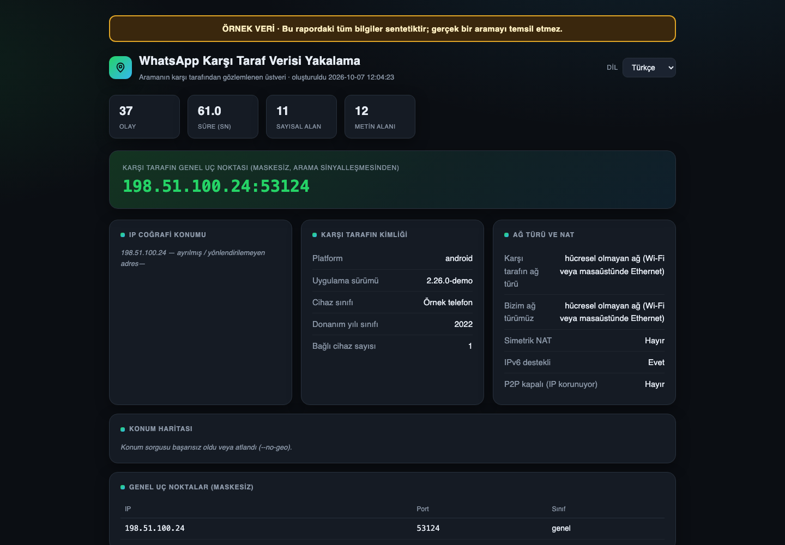
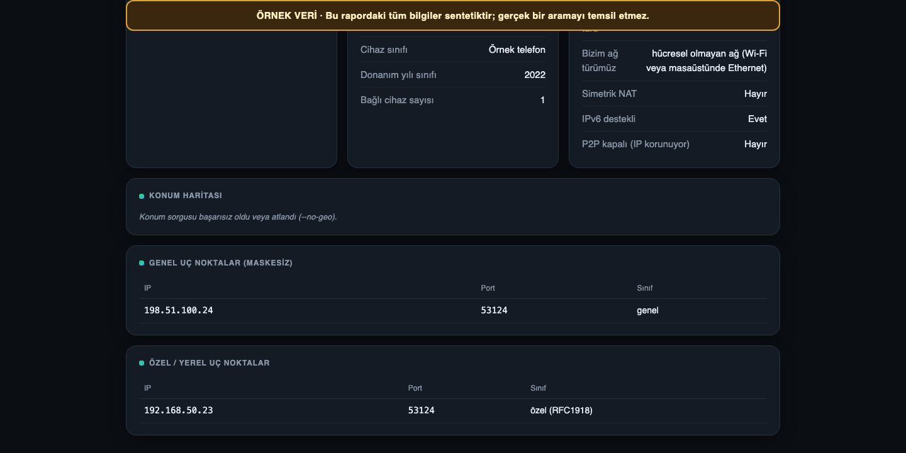

# WhatsApp Arama Raporu (Türkçe masaüstü arayüzü)

Bu çalışma, [0x6rss/chat-apps-osint](https://github.com/0x6rss/chat-apps-osint) projesi **referans alınarak ve onun WhatsApp kodu temelinde** geliştirilmiştir. Özgün projenin telif hakkı 0x6rss'a aittir ve kodu [MIT Lisansı](LICENSE) kapsamında dağıtılır. Bu sürüm Türkçe açıklamalar, masaüstü arayüzü ve rapor görüntüleme akışı ekler; özgün projeyle resmî bir bağlantısı yoktur.

## Platform desteği

| Sistem | Canlı WhatsApp araması yakalama | Masaüstü arayüzündeki rapor işlemi | Uygulama oluşturma |
| --- | --- | --- | --- |
| Windows | Var; `WhatsApp.Root.exe` ve `WhatsAppNative.Voip.dll` kullanan sürüme bağlıdır | Son HTML raporunu açma; JSON, JSONL ve HTML içe aktarma | `whatsapp/build_windows.bat` |
| macOS | Desteklenmiyor | JSON, JSONL ve HTML dosyası içe aktarma | `whatsapp/build_macos.sh` |
| Linux | Desteklenmiyor | JSON, JSONL ve HTML dosyası içe aktarma | `whatsapp/build_linux.sh` |

[Frida macOS ve Linux'ta da çalışır](https://frida.re/docs/installation/); ancak bu projenin yakalama kodu Windows'a özgü DLL, PE dosya yapısı ve işlev adreslerini kullanır. Mac ve Linux uygulamalarındaki **Raporu incele** işlevi mevcut dosyaları görüntüler; WhatsApp aramasından yeni veri yakalamaz. [WhatsApp'ın resmî masaüstü uygulaması](https://www.whatsapp.com/download/desktop?lang=tr) Windows ve Mac için sunulur. Linux'ta [WhatsApp Web araması](https://faq.whatsapp.com/2092488194268012/?cms_platform=web&locale=vi_VN) kullanılabilir; bu yakalama kodu Web aramasına bağlanmaz.

Kurulum, platforma göre kullanım ve rapor alanlarının açıklamaları için [WhatsApp kılavuzuna](whatsapp/README.md) bakın.

## Hazır paketleri indirme

Bu türev GitHub'a yüklendikten ve iş akışı başarıyla tamamlandıktan sonra deponun **Actions → Masaüstü paketleri → en yeni başarılı çalıştırma → Artifacts** bölümünü açın:

- `WhatsAppAramaRaporu-Windows`: Windows EXE.
- `WhatsAppRaporGoruntuleyici-macOS-arm64`: Apple Silicon Mac için `.app` ZIP dosyası.
- `WhatsAppRaporGoruntuleyici-macOS-x64`: Intel Mac için `.app` ZIP dosyası.
- `WhatsAppRaporGoruntuleyici-Linux`: Linux uygulaması içeren `.tar.gz` dosyası.

Mac yapıtları GitHub Actions üzerindeki **macOS 15**, Linux yapıtı **Ubuntu 24.04** ortamında üretilir. Daha eski bir sistemde uyumluluk için kendi sisteminizdeki [paketleme betiğini](whatsapp/README.md) çalıştırın. Henüz başarılı bir Actions çalışması yoksa hazır indirme de yoktur.

## Hızlı kullanım

1. İşletim sisteminize uygun hazır paketi indirin veya `whatsapp` klasöründeki paketleme betiğini kendi sisteminizde çalıştırın. [PyInstaller](https://pyinstaller.org/en/latest/) her işletim sistemi için paketin o sistemde oluşturulmasını gerektirir.
2. Oluşturulan masaüstü uygulamasını açın.
3. **Windows:** WhatsApp masaüstü uygulamasında arama yaparken **Yakalamayı başlat** seçeneğini kullanın; aramayı bitirdikten sonra **Durdur ve rapor oluştur** seçeneğine basın.
4. **Tüm sistemler:** **Rapor inceleme** bölümünde önceden oluşturulmuş `.json`, `.jsonl` veya `.html` dosyasını **Dosya seç…** ile seçip **Raporu incele** seçeneğine basın. Denemek için [sentetik örnek raporu](whatsapp/examples/demo_report.json) seçebilirsiniz.

## Ekran görüntüleri

İki görüntü de [sentetik örnek JSON verisinden](whatsapp/examples/demo_report.json) üretilmiş **gerçek HTML raporunun tarayıcı ekran görüntüleridir**; gerçek bir aramayı veya masaüstü uygulaması penceresini göstermez. Masaüstü arayüzü görüntüleri henüz eklenmemiştir. Bunlar için önerilen dosya adları `docs/screenshots/windows-yakalama.png` ve `docs/screenshots/mac-linux-rapor-goruntuleme.png`.

Yalnızca kendi hesabınızda, açık rızayla veya yetkili araştırmada kullanın. Yakalanan raporlar IP adresi gibi kişisel veriler içerebilir.

[English README](README.en.md)
