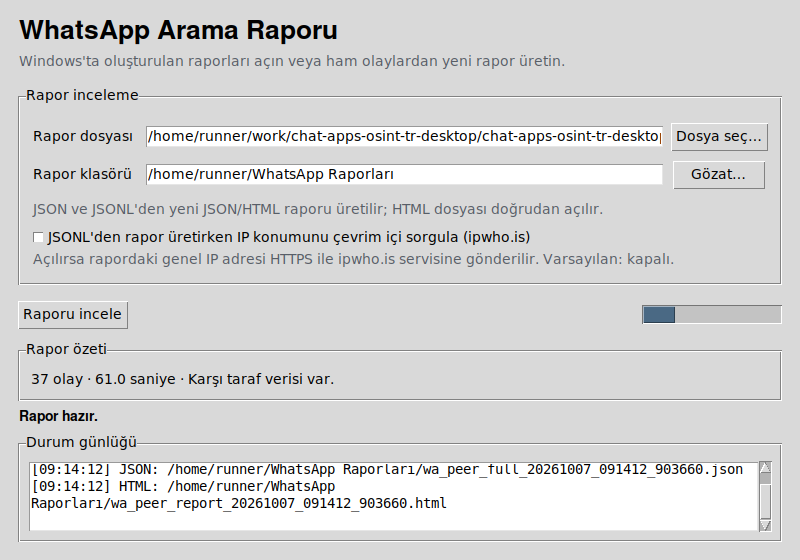

# WhatsApp Arama Raporu: yakalama ve rapor görüntüleme

Windows yakalama bileşeni, WhatsApp istemcisinin sesli veya görüntülü arama sırasında zaten gördüğü karşı tarafa ait meta verileri gösteren bir Frida aracıdır. Yalnızca gözlem yapmak için çalışan sürece bağlanır; uygulamanın belleğinde zaten bulunan değerleri okuyup çıktıya yazar. Yakalama için yeni ağ trafiği oluşturmaz ve hiçbir değeri değiştirmez. Masaüstü arayüzü Windows'ta yakalama, Mac ve Linux'ta mevcut raporları görüntüleme işlevi sunar.

Aracı yalnızca kendi hesaplarınız veya cihazlarınız arasında, karşı tarafın açık rıza verdiği araştırma ya da eğitim çalışmalarında veya yetkili bir görev kapsamında kullanın.

[Özgün proje: 0x6rss/chat-apps-osint](https://github.com/0x6rss/chat-apps-osint). Bu sürüm özgün WhatsApp kodu temel alınarak geliştirilmiştir. Özgün telif hakkı 0x6rss'a aittir; [MIT lisansı](../LICENSE) korunmuştur. Masaüstü arayüzü ve Türkçe belgeler bu türevin ekleridir.

[English README](README.en.md)

---

## Hangi özellik hangi sistemde çalışır?

| Özellik | Windows | macOS | Linux |
| --- | --- | --- | --- |
| WhatsApp aramasından canlı meta veri yakalama | Evet, desteklenen WhatsApp masaüstü sürümlerinde | Hayır | Hayır |
| Son yakalamanın HTML raporunu açma | Evet | Uygulanmaz | Uygulanmaz |
| Var olan JSON, JSONL veya HTML dosyasını arayüzden içe aktarma | Evet | Evet | Evet |
| İçe aktarılan JSON/JSONL dosyasından HTML raporu oluşturma | Evet | Evet | Evet |

Yakalama kodu `WhatsApp.Root.exe` sürecindeki `WhatsAppNative.Voip.dll` dosyasının Windows PE işlevlerine bağlanır. Mac ve Linux için yalnızca paketleme betiği çalıştırmak bu kodu orada kullanılabilir yapmaz. [WhatsApp'ın resmî masaüstü sürümleri](https://www.whatsapp.com/download/desktop?lang=tr) Windows ve Mac içindir. [WhatsApp Web araması](https://faq.whatsapp.com/2092488194268012/?cms_platform=web&locale=vi_VN) Linux'ta da desteklenir; bu aracın Windows yakalama kodu Web aramasına bağlanmaz.

## Masaüstü uygulaması (Windows)

Komut satırı kullanmadan çalıştırmak için Windows'ta `build_windows.bat` dosyasına çift tıklayın. Bu işlem gerekli Python paketlerini ayrı bir `.venv` klasörüne yükler ve `dist/WhatsAppAramaRaporu.exe` dosyasını oluşturur. Oluşturulan EXE'yi çift tıklayarak açabilirsiniz. [PyInstaller](https://pyinstaller.org/en/stable/) Windows uygulamasını Windows üzerinde derlediği için bu adımı Windows'ta yapın.

Python ve aşağıdaki bağımlılıklar zaten kuruluysa `wa_peer_gui.pyw` dosyasına çift tıklayarak uygulamayı doğrudan açabilirsiniz.

Uygulamada rapor klasörünü ve isteğe bağlı süreyi seçin; **Yakalamayı başlat** düğmesine basın. WhatsApp'ta aramayı başlatın veya kabul edin. Önce aramayı WhatsApp içinde bitirin, sonra **Durdur ve rapor oluştur** düğmesine basın. JSON ve HTML raporları seçtiğiniz klasöre yazılır; HTML raporunu uygulamadan açabilirsiniz.

**Rapor inceleme** sekmesi mevcut `.json`, `.jsonl` ve `.html` dosyalarını da açar. Windows'ta yakalama yapmadan arayüzü denemek için [sentetik örnek raporu](examples/demo_report.json) seçebilirsiniz.

Çevrim içi IP konum sorgusu varsayılan olarak kapalıdır. Bu seçeneği açarsanız karşı tarafın genel IP adresi HTTPS üzerinden ipwho.is servisine gönderilir. Konum içeren HTML raporunu açtığınızda Leaflet dosyaları ve OpenStreetMap harita döşemeleri de internetten yüklenir.

---

## Masaüstü uygulaması (macOS ve Linux)

Bu sistemlerde uygulama **rapor görüntüleyici** olarak açılır; WhatsApp'tan canlı veri yakalamaz. Daha önce Windows sürümüyle oluşturulmuş bir raporu Mac veya Linux'a taşıyıp inceleyebilirsiniz.

1. Python 3.10 veya üzeri ve Tk 8.6 veya üzeri kurun. Linux'ta Tkinter ayrı bir sistem paketi olabilir (`python3-tk` gibi).
2. `whatsapp` klasöründe macOS için `./build_macos.sh`, Linux için `./build_linux.sh` çalıştırın. Betik, ayrı bir sanal ortamda PyInstaller kurar ve uygulamayı paketler. PyInstaller her sistem için [o sistemde çalıştırılmalıdır](https://pyinstaller.org/en/latest/).
3. Mac'te `dist/WhatsAppRaporGoruntuleyici.app` dosyasını; Linux'ta `dist/WhatsAppRaporGoruntuleyici/WhatsAppRaporGoruntuleyici` uygulamasını dosya yöneticisinden açın.
4. **Rapor dosyası** alanında **Dosya seç…** ile `wa_peer_full_*.json`, `wa_peer_raw_*.jsonl`, [sentetik örnek rapor](examples/demo_report.json) veya mevcut `.html` raporunu seçin. JSON ve JSONL için **Rapor klasörü** alanında çıktı dizinini seçin; ardından **Raporu incele** düğmesine basın. **Son raporu aç** ve **Rapor klasörünü aç** düğmeleriyle sonucu görüntüleyin.

JSONL dosyası ham yakalama olaylarını içerir; uygulama buradan yeni JSON ve HTML raporu üretir. HTML dosyası doğrudan tarayıcıda açılır. İçe aktarma sırasında IP konum sorgusu varsayılan olarak kapalıdır. Frida ve WhatsApp masaüstü uygulaması rapor görüntüleme için gerekli değildir.

Kaynak koddan açmak isterseniz `python3 wa_peer_gui.py` komutunu kullanın; aynı Python kurulumunda Tkinter bulunmalıdır. `build_macos.sh` ve `build_linux.sh` **çalıştırılabilir paketleri kendi işletim sistemlerinde üretir**; burada hazır imzalı veya başka sistemde test edilmiş paketler sunulmaz.

### GitHub Actions üzerinden hazır paket

[Masaüstü paketleri iş akışını](https://github.com/gorkemguler/chat-apps-osint-tr-desktop/actions/workflows/build-desktop.yml) açıp en yeni başarılı çalıştırmanın **Artifacts** bölümüne gidin. `WhatsAppAramaRaporu-Windows` yapıtı EXE içerir. `WhatsAppRaporGoruntuleyici-macOS-arm64` Apple Silicon, `WhatsAppRaporGoruntuleyici-macOS-x64` Intel Mac içindir; her ikisi `.app` ZIP arşivi içerir. `WhatsAppRaporGoruntuleyici-Linux` yapıtı `.tar.gz` içerir. Mac ve Linux arşivlerini açıp uygulamayı dosya yöneticisinden başlatın. Başarılı CI derlemesi canlı Mac/Linux yakalama desteği anlamına gelmez.

Mac paketleri Actions üzerinde macOS 15, Linux paketi Ubuntu 24.04 ortamında üretilir. Daha eski işletim sistemleri veya Linux dağıtımları için kendi sisteminizde paketleme betiğini kullanın; eski sistemlerle hazır yapıtların uyumluluğu doğrulanmadı.

Yerel Mac ortamında Tkinter içeren güncel bir Python yoksa `build_macos.sh` paket oluşturmadan açık bir hata verir. Bu durumda Tk 8.6+ içeren Python kurulumunu `BUILD_PYTHON=/tam/yol/python3 ./build_macos.sh` ile seçin veya başarılı Actions yapıtını kullanın.

### Ekran görüntüleri



Bu, Linux üzerinde açılmış gerçek rapor görüntüleme arayüzüdür; [sentetik örnek rapor](examples/demo_report.json) kullanılmıştır.


Son iki görüntü, aynı sentetik verilerden üretilmiş gerçek HTML raporunun tarayıcı ekran görüntüleridir; gerçek aramayı göstermez.

---

## Windows canlı yakalama gereksinimleri

- Windows ve Python 3.10 veya üzeri.
- Frida (Python): `pip install -r requirements.txt` (16.x ve 17.x sürümleriyle çalışır).
- Windows için WhatsApp'ın yüklü, çalışır ve oturum açılmış olması gerekir (`WhatsApp.Root.exe` süreci). Yönetici yetkisi gerekmez.

## Kurulum

```
pip install -r requirements.txt
```

## Çalıştırma

```
python wa_peer.py
```

1. Windows için WhatsApp'ı açın ve oturumunuzun açık olduğundan emin olun.
2. Yukarıdaki komutu çalıştırın ve `WhatsApp.Root.exe` sürecine bağlanıldığını, kancaların (hook) kurulduğunu bildiren satırı bekleyin.
3. Bir arama başlatın veya gelen aramayı kabul edin. Yaklaşık 20-30 saniye yeterlidir; karşı taraf ne kadar çok konuşursa ses düzeyi ölçüm dizisi o kadar dolu olur.
4. Önce WhatsApp içinden aramayı sonlandırın, 2-3 saniye bekleyin, ardından Ctrl+C tuşlarına basın.

Bilmeniz gerekenler:

- Aracı durdurmadan önce aramayı sonlandırın. `app_version`, `device_class`, `medium` ve `nat` gibi alanlar yalnızca arama bittikten sonra oluşan arama sonu istatistiklerinden gelir.
- PowerShell'de Ctrl+C ile birlikte `> file.json` kullanmayın; PowerShell kesme sırasında yönlendirilen dosyayı siler. Bunun yerine `--seconds N` veya `--raw` kullanın ya da raporu ekrandan okuyun.

### Kullanım örnekleri

```
python wa_peer.py --seconds 60     # 60 saniye sonra otomatik durur
python wa_peer.py --no-geo         # çevrimiçi IP konum sorgusunu atlar
python wa_peer.py --compact        # rapor JSON'unu tek satırda yazdırır
python wa_peer.py --raw raw.jsonl  # ham olay akışını (JSONL) ayrıca kaydeder
```

### Parametreler

| Parametre | Açıklama |
|---|---|
| `--process İŞLEM` | Bağlanılacak süreç (varsayılan: `WhatsApp.Root.exe`) |
| `--seconds SANİYE` | Belirtilen süre sonra otomatik durur (0 = Ctrl+C basılana kadar çalışır) |
| `--raw DOSYA` | Ham olay akışını (JSONL) belirtilen dosyaya da yazar |
| `--no-geo` | Yakalama sırasında çevrim içi IP konum sorgusunu atlar |
| `--no-browser` | HTML raporunu yazar ancak tarayıcıda açmaz |
| `--outdir DİZİN` | JSON ve HTML raporlarının yazılacağı dizin (varsayılan: geçerli dizin) |
| `--compact` | Rapor JSON'unu tek satırda yazdırır |

## Çıktı

Araç her çalıştırıldığında iki dosya oluşturur ve raporu ekrana yazdırır:

- `wa_peer_full_<timestamp>.json`: Yakalanan bütün alanları içeren ayrıntılı veri dosyası.
- `wa_peer_report_<timestamp>.html`: Tarayıcıda açılan gösterge paneli. Türkçe, İngilizce, Rusça, Arapça ve Çince dil seçenekleri ile karşı tarafın IP konumunu gösteren bir harita içerir.

HTML raporu üst bilgiler, kimlik, ağ, NAT, konum durumu ve uç noktalar için kısa bir görsel özettir. Telemetri, davranış, parmak izi ve diğer tam alanlar JSON raporunda bulunur.

---

## Verilerin anlamı

### Ağ ve konum (`peer.network`)

| Alan | Açıklama |
|---|---|
| `public_endpoints` | İnternetten görülen, maskelenmemiş genel IP adresi ve bağlantı noktası. Konum bilgisi bu adresten elde edilir. |
| `private_endpoints` | Karşı tarafın yerel ağ adresi (`192.168.x`, `10.x`) veya operatör düzeyinde NAT adresi (`100.64.x`). Özel adres ev/ofis Wi-Fi bağlantısını, CGNAT adresi ise mobil veriyi gösterir. |
| `geolocation` | Karşı tarafın genel IP adresinden ipwho.is aracılığıyla elde edilen ülke, bölge, şehir, koordinatlar, internet servis sağlayıcısı (ISP) ve otonom sistem (AS) bilgileri. Haritada kullanılır. |
| `telemetry_view.peer_public_ip_masked` | Aynı IP adresinin WhatsApp telemetrisinde kaydedilen, /24 düzeyinde maskelenmiş hâli. |
| `medium.peer` / `medium.self` | Her iki tarafın bağlantı türü: hücresel, Wi-Fi/Ethernet veya yok. |
| `nat.symmetric` | Karşı tarafın simetrik NAT arkasında olup olmadığı. |
| `nat.p2p_disabled` | “Aramalarda IP adresini koru” seçeneğinin etkin olup olmadığı. Değer `false` ise karşı tarafın gerçek adresi paylaşılmıştır. |
| `nat.ipv6_capable` | Karşı tarafın IPv6 sunup sunmadığı. |

### Kimlik ve cihaz (`peer.identity`)

| Alan | Açıklama |
|---|---|
| `platform` | Karşı tarafın platformu: android, iphone, windows, web, mac, ipad vb. |
| `app_version` | Karşı tarafın WhatsApp sürümü; örneğin `2.26.30.97`. |
| `device_class` | WhatsApp'ın karşı tarafın cihazı için kullandığı performans sınıfı: High / Mid / Low. |
| `hardware_year_class` | Karşı tarafın cihazının yaklaşık donanım nesli; örneğin `2016`. |
| `linked_device_count` | Karşı tarafın hesabına bağlı eşlikçi cihaz sayısı. |

### JSON dosyasındaki diğer alanlar

- `peer.behaviour`: Konuşma etkinliği ölçüm dizisi, sessizlik süresi ve oranı.
- `peer.fingerprint`: Karşı taraftan gelen verileri tanımlayan kodek ve zamanlama değerleri (çerçeve uzunluğu, çözme süresi, jitter tamponu ve tahmini gönderme bant genişliği).
- `peer.correlation`: Aynı cihaza yapılan aramalarda sabit kalan A/B testi grup kimliği ve bu aramada görülen arama kimlikleri.
- `peer.relays`: Meta aktarma sunucuları ve gecikme örnekleri.
- `self`: Karşı tarafa ait değerlerle karışmaması için eklenen kendi adreslerimiz.

### Notlar

- Bu katmanda telefon numarası veya JID bulunmaz; VoIP katmanı bunun yerine arama kimliğiyle çalışır.
- Yakalanan genel IP adresinden elde edilen konum, sokak düzeyinde değil şehir veya operatör düzeyinde güvenilirdir (mobil IP adresleri baz istasyonu havuzlarından gelir).
- Aktarma sunucusunun gecikmesi konum bilgisi vermez; yalnızca ağ mesafesi hakkında kaba bir ipucu sunar ve çoğu zaman gerçek bir ölçüm bile değildir.
